# Figures 49–70

[Results index](README.md) | [Previous](figures-0001.md)

[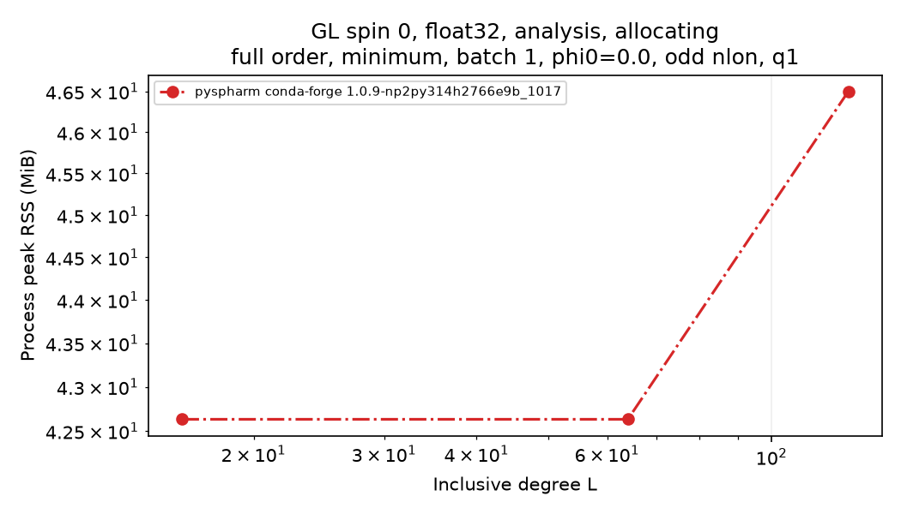](GL-spin0-float32-allocating-analysis-full-minimum-batch1-phi0.0-odd-q1-peak_rss_bytes.png)

[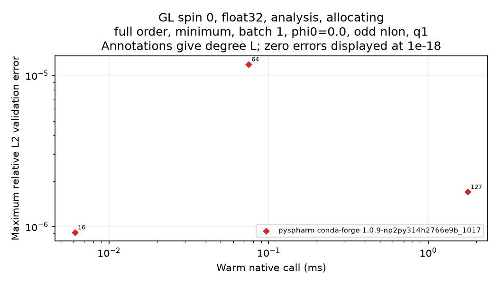](GL-spin0-float32-allocating-analysis-full-minimum-batch1-phi0.0-odd-q1-error-vs-latency.png)

[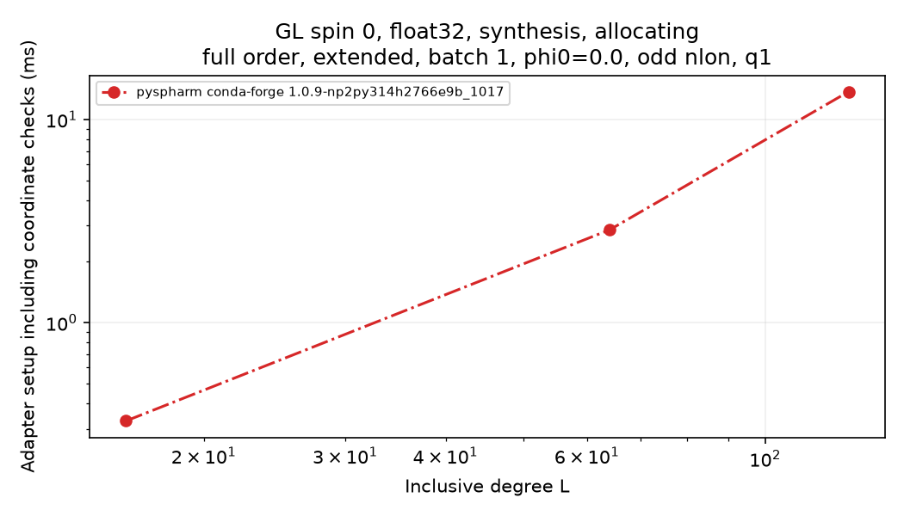](GL-spin0-float32-allocating-synthesis-full-extended-batch1-phi0.0-odd-q1-setup_s.png)

[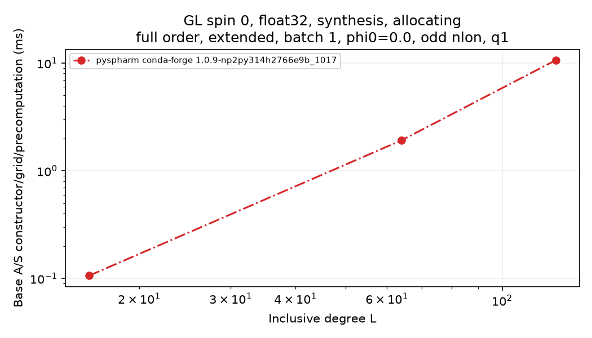](GL-spin0-float32-allocating-synthesis-full-extended-batch1-phi0.0-odd-q1-native_setup_s.png)

[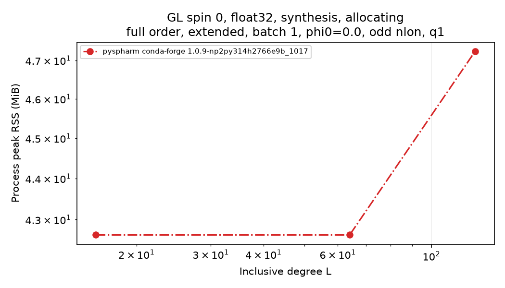](GL-spin0-float32-allocating-synthesis-full-extended-batch1-phi0.0-odd-q1-peak_rss_bytes.png)

[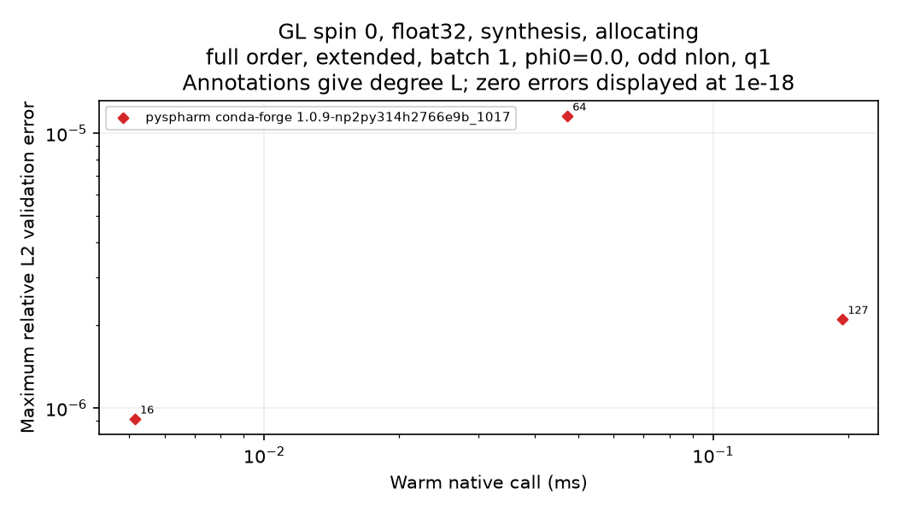](GL-spin0-float32-allocating-synthesis-full-extended-batch1-phi0.0-odd-q1-error-vs-latency.png)

[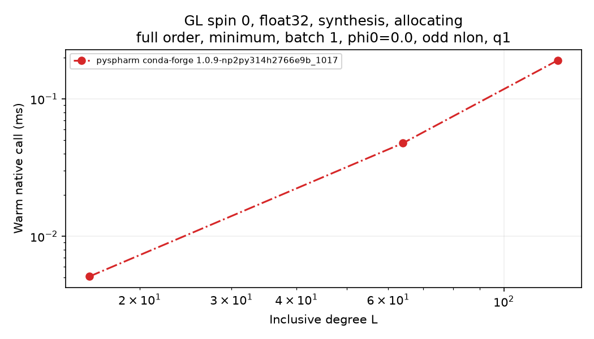](GL-spin0-float32-allocating-synthesis-full-minimum-batch1-phi0.0-odd-q1-median_s.png)

[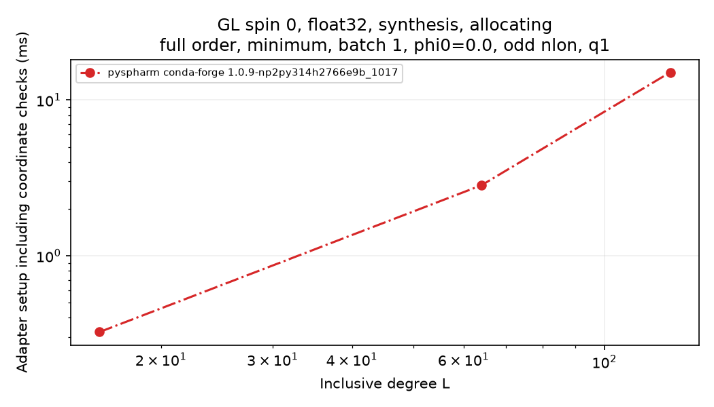](GL-spin0-float32-allocating-synthesis-full-minimum-batch1-phi0.0-odd-q1-setup_s.png)

[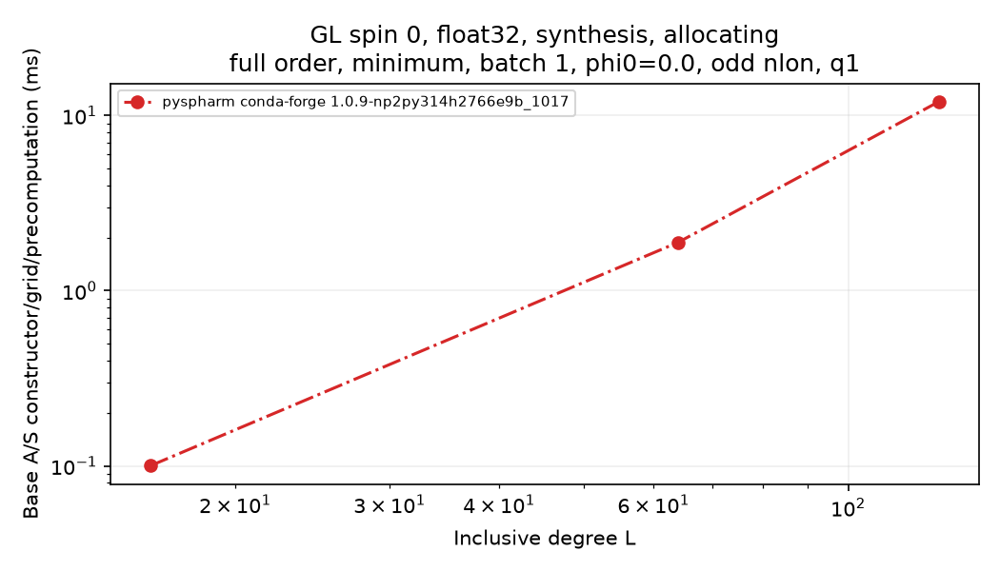](GL-spin0-float32-allocating-synthesis-full-minimum-batch1-phi0.0-odd-q1-native_setup_s.png)

[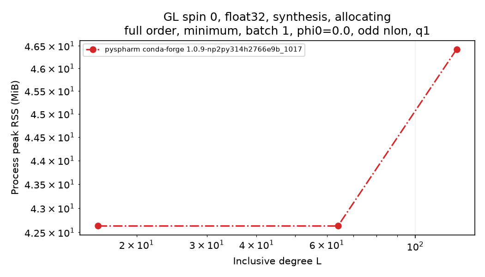](GL-spin0-float32-allocating-synthesis-full-minimum-batch1-phi0.0-odd-q1-peak_rss_bytes.png)

[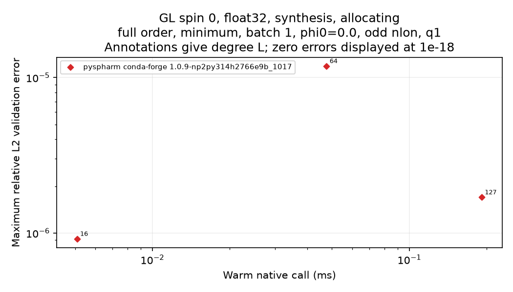](GL-spin0-float32-allocating-synthesis-full-minimum-batch1-phi0.0-odd-q1-error-vs-latency.png)

[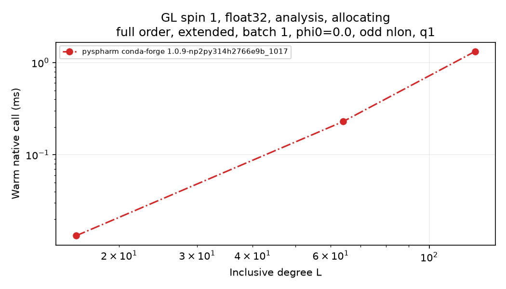](GL-spin1-float32-allocating-analysis-full-extended-batch1-phi0.0-odd-q1-median_s.png)

[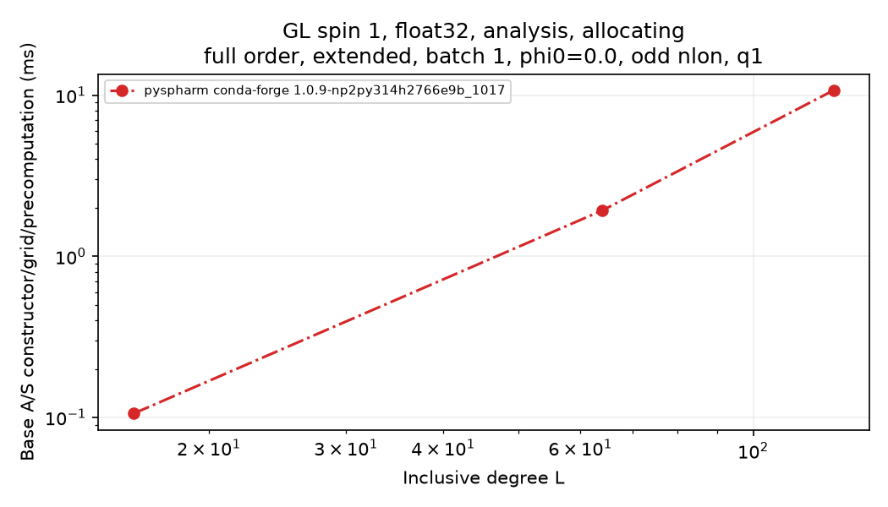](GL-spin1-float32-allocating-analysis-full-extended-batch1-phi0.0-odd-q1-native_setup_s.png)

[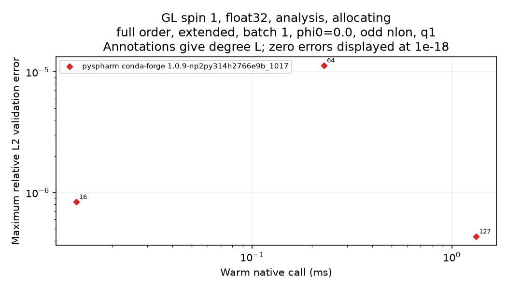](GL-spin1-float32-allocating-analysis-full-extended-batch1-phi0.0-odd-q1-error-vs-latency.png)

[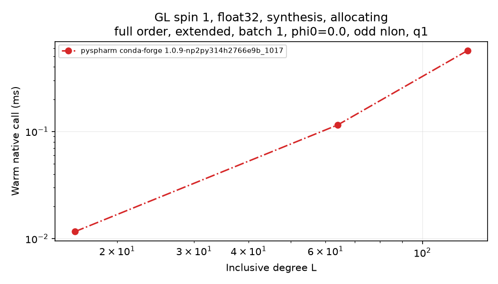](GL-spin1-float32-allocating-synthesis-full-extended-batch1-phi0.0-odd-q1-median_s.png)

[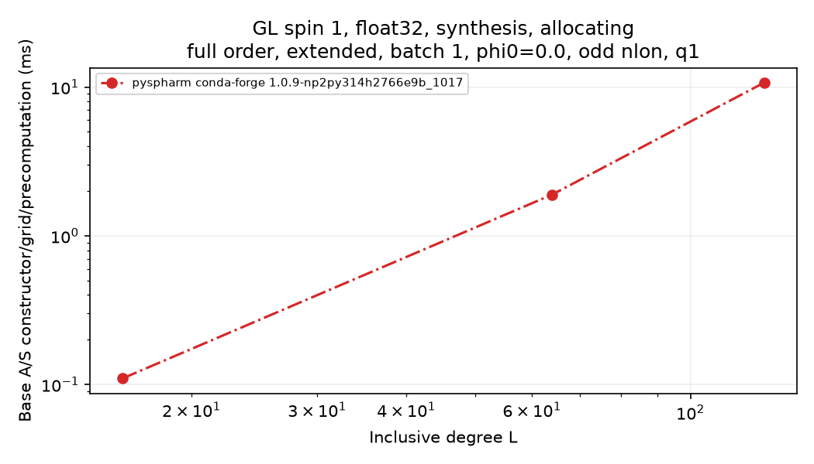](GL-spin1-float32-allocating-synthesis-full-extended-batch1-phi0.0-odd-q1-native_setup_s.png)

[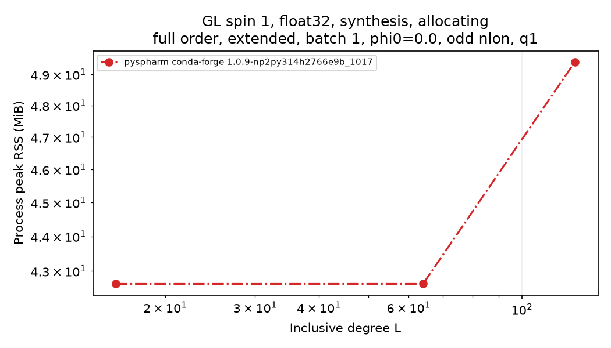](GL-spin1-float32-allocating-synthesis-full-extended-batch1-phi0.0-odd-q1-peak_rss_bytes.png)

[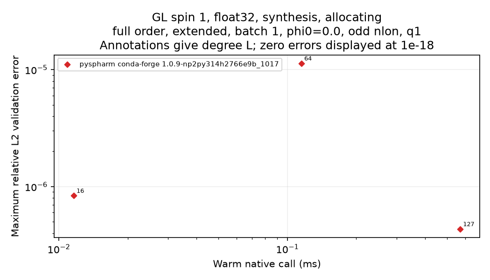](GL-spin1-float32-allocating-synthesis-full-extended-batch1-phi0.0-odd-q1-error-vs-latency.png)

