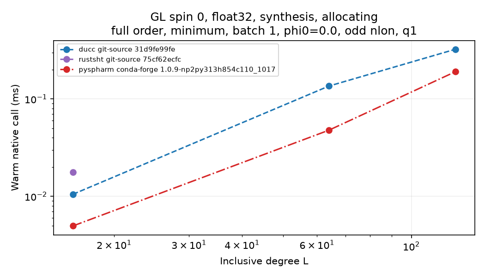
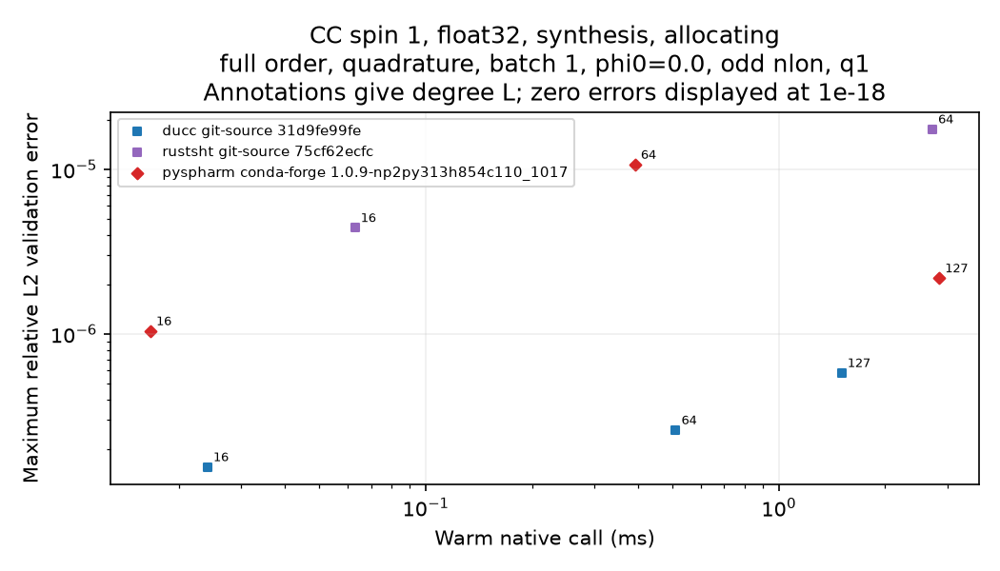

# pyspharm conda-forge benchmark results — 2026-10-25

## Build and runtime

The active Spherepack backend is conda-forge `pyspharm 1.0.9`, build
`np2py313h854c110_1017`, from the `conda-forge` main channel for `linux-64`.
It runs in its own conda environment with CPython 3.13.15 and NumPy 2.5.4.
The `spharm` Python package and `_spherepack` extension resolve inside that
environment. Analysis returns `complex64` coefficients and synthesis returns
`float32` maps. The native extension links to `libm`, `libc`, and the system
loader; it does not expose a linked FFT, BLAS, or LAPACK library.

All benchmark environments used for this migration run use Python 3.13.15,
not Python 3.14. The uv matrix environment uses NumPy 2.5.3; the conda
environment and matched source-matrix controls use NumPy 2.5.4. Result rows
retain the environment versions and build origin. The conda build is shown in
the stable pyspharm red with a dash-dot line, separate from wheel and Git
source builds.

The [environment provenance](../environments/pyspharm-conda-forge-linux-64.provenance.json)
records the channel, artifact URL, SHA-256 and MD5 hashes, Python and NumPy
artifacts, NumPy ABI, import and extension paths, precision, dynamic linkage,
and explicit conda exports.

## Rerun results

The three-round q1 source matrix recorded 1,824 pyspharm outcomes. Of these,
126 were timed and passed every numerical gate; 1,698 were explicitly marked
unsupported. No pyspharm cell failed numerical validation or execution. The
supported cells use float32/complex64, batch 1, full triangular truncation,
allocating calls, and one requested thread. The run covered `lmax` 16, 64,
and 127 with three isolated process rounds and 30 warm repetitions per cell.

The retained source q1 data include all outcomes and reasons, per-cell
timings, all numerical validation stages, matched ratios, and three-process
paired summaries: [outcomes](data/pyspharm-conda-forge-2026-10-25/source-q1-outcomes.csv),
[timings](data/pyspharm-conda-forge-2026-10-25/source-q1-timings.csv),
[accuracy](data/pyspharm-conda-forge-2026-10-25/source-q1-accuracy.csv),
[matched ratios](data/pyspharm-conda-forge-2026-10-25/source-q1-matched-ratios.csv),
and [paired summary](data/pyspharm-conda-forge-2026-10-25/source-q1-paired-summary.csv).
The [run summary](data/pyspharm-conda-forge-2026-10-25/source-q1-summary.json)
contains status counts, validation maxima, unsupported reasons, and build and
harness hashes. Unsupported outcomes remain visible in the data.

For an interpretable matched comparison, the table below selects float32,
`lmax=mmax=64`, batch 1, allocating calls, q1, and three process pairs. Each
row compares the same geometry and operation against DUCC float32. GL scalar
minimum uses 65×129; GL vector uses 66×129 so the highest-degree spin-1 modes
are observable; CC quadrature uses 130×129. The ratios summarize paired
process rounds and need not equal ratios of the displayed median latencies.

| Grid and geometry | Spin | Operation | pyspharm (ms) | DUCC (ms) | Ratio |
| --- | ---: | --- | ---: | ---: | ---: |
| GL minimum, 65×129 | 0 | Analysis | 0.07452 | 0.12833 | 0.579 |
| GL minimum, 65×129 | 0 | Synthesis | 0.04777 | 0.13562 | 0.348 |
| GL extended, 66×129 | 1 | Analysis | 0.22211 | 0.24615 | 0.902 |
| GL extended, 66×129 | 1 | Synthesis | 0.11428 | 0.27125 | 0.421 |
| CC quadrature, 130×129 | 0 | Analysis | 0.28097 | 0.35988 | 0.781 |
| CC quadrature, 130×129 | 0 | Synthesis | 0.13745 | 0.24489 | 0.560 |
| CC quadrature, 130×129 | 1 | Analysis | 0.88193 | 0.70699 | 1.243 |
| CC quadrature, 130×129 | 1 | Synthesis | 0.39125 | 0.50978 | 0.764 |

These are workload-specific measurements on a shared host. They do not imply
general performance superiority or thread scaling.

The legacy matrix command reran 180 timing records: 100 GL and 80 CC records,
covering analysis and synthesis at requested thread counts 1, 2, 4, 8, and 16.
The backend is serial and does not expose per-call thread control. Each record
retains seven raw timing samples, a three-call warmup, and the 0.2-second
minimum timing window in the [machine-readable matrix](data/pyspharm-conda-forge-2026-10-25/legacy-matrix.json)
and [CSV summary](data/pyspharm-conda-forge-2026-10-25/legacy-matrix.csv).
The [regenerated legacy chart gallery](../results/matrix/plots/README.md)
contains the refreshed GL/CC comparisons, thread slices, stable colors, and
the exact conda build in its legends and methodology.

*GL scalar synthesis on the minimum grid. The red dash-dot series is conda-forge `pyspharm 1.0.9`, build `np2py313h854c110_1017`; source-matrix q1, float32/complex64, three rounds.*

*CC quadrature spin-1 synthesis latency and maximum validation error for full-order q1 cells. The legend identifies the conda-forge package build; errors remain below the unchanged float32 tolerance of `5e-5`.*

## Numerical behavior and capability limits

All 4,086 recorded pyspharm validation-stage records passed. The largest
relative L2 error was `1.20e-5`, below the unchanged float32 acceptance
threshold of `5e-5`. The run checked independent synthesis, coefficient
recovery, and map round trips. Analytical scalar and spin-1 mode probes,
batching, supported GL and CC geometries, and odd/even longitude lengths
passed for the tested fixtures.

| Case | Current evidence and handling |
| --- | --- |
| GL minimum spin-1 (`nlat=L+1`) | The highest-degree modes are not observable on this grid. The 18 q1 outcomes are unsupported; spin-1 runs use at least `nlat=L+2`, where validation passes. |
| GL 32×33, L16 | The conda build still reports `vhsgsi ierror=3` during initialization. The affected source-matrix variants are recorded as unsupported; they are not retried or timed. |
| CC L63 highest-mode precision probes | The minimum and quadrature scalar/vector probes fail coefficient recovery and map round-trip checks for highest-degree modes; maximum relative L2 is `9.40e-5`, above the unchanged `5e-5` tolerance. The two regular-grid controls pass. These are standalone diagnostics, not timed q1 cells; see the [machine-readable probe summary](data/pyspharm-conda-forge-2026-10-25/cc-l63-precision-probes.json). |
| CC L1023 | The package-specific exclusion was removed. A dynamic preflight estimates at least 51.5 GB for stored plan arrays; with about 70.9 GB available, the host is below the 2× headroom threshold, so this case was not attempted. |
| Other unsupported dimensions | The public API is float32/complex64, full-triangular only, has no native F1 path, and exposes no output-buffer API. These exclusions are recorded per outcome. |

The limited source-resolution smoke audited 16/16 outcomes. It timed eight
full-order cells and marked eight half-order requests unsupported because the
public API accepts only full triangular truncation. Four of four numerical
gates passed. Its [summary data](data/pyspharm-conda-forge-2026-10-25/source-resolution-summary.json)
and regenerated resolution, setup, first-call, and error figures are included
in the same [figure directory](figures/pyspharm-conda-forge-2026-10-25/).

## Provenance and reproduction

The DUCC, SHTns, and RustSHT source revisions are unchanged:

| Backend | Ref | SHA |
| --- | --- | --- |
| DUCC | `ducc0` | `31d9fe99fefa5ca29df17b7e6d2362b8c5c4a05f` |
| SHTns | `master` | `4e69ceb3fc5f19475d55b03ff0fdec210dc3075e` |
| RustSHT | `main` | `75cf62ecfc4a324fc4f7d9e652c3d285dbf32cc4` |

Source q1 build-manifest SHA-256 is
`d6fe72d153a3357828f7ca52d865ee08de462d11e0e915f2e4e05092ca14286b`; its
harness SHA-256 is
`b0ef7551bd462f6da1f3232e7b8eec12f31a8c91ecaa47669930b2555d486d0e`.
The pyspharm artifact SHA-256 is
`2f12e25a18c47c9a7545cb36a29cfecd553a42dde7df30b06af1d08def5986fc`.

Compact current result exports are tracked under
[`docs/data/pyspharm-conda-forge-2026-10-25`](data/pyspharm-conda-forge-2026-10-25/README.md).
The extensive per-cell logs remain local benchmark output and are not linked
from this published report.
