# GL/CC scaling comparison: RustSHT dev refresh

This comparison starts from the complete [dense-to-L1024 baseline](../results/gl-cc-resolution-scaling-l1024/) and replaces only its RustSHT cells with a new run from RustSHT `dev`, commit `3194dc095c71343931b2ba0cfa0fc4f72dcab4cf`. DUCC, SHTns, and conda-forge pyspharm JSON cells and CSV rows are unchanged. The original RustSHT `main` measurements at `579c09e` remain in the baseline for direct comparison.

The refreshed RustSHT matrix has **1,480 successful operation cells across 740 worker groups**. The merged comparison has 3,816 successful timings and the same 8 pyspharm GL synthesis finite-output failures as its baseline, with no resource-limited cells. Measurements are exploratory timing-only results: output shape, dtype, and finiteness were checked, but numerical accuracy was not revalidated. The protocol remains one warmup, three calibrated samples, one process round, full triangular order, and setup excluded from warm-call timing.

## Float64 primary results

The first eight figures compare DUCC, refreshed RustSHT `dev`, and SHTns. Each has q1/q2/q4/q8/q16 panels; markers are measured points and lines stop at missing or failed degrees.

### GL, float64

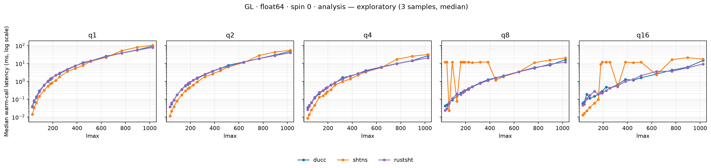

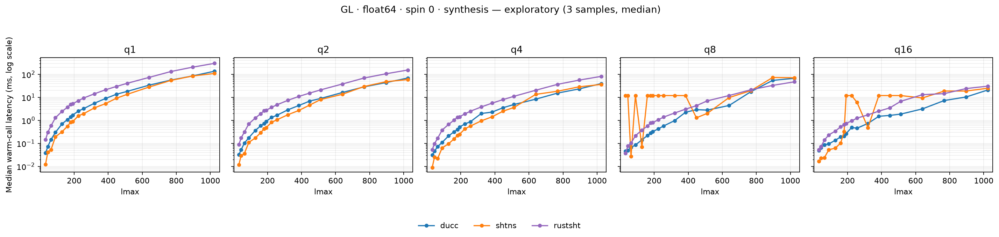

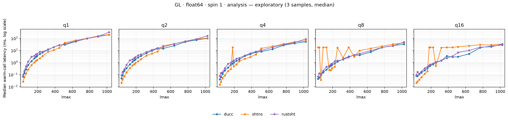

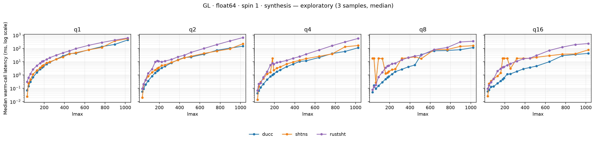

### CC, float64

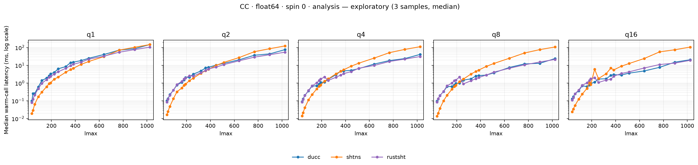

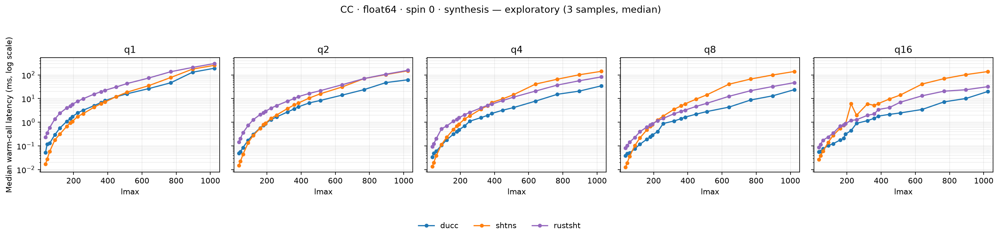

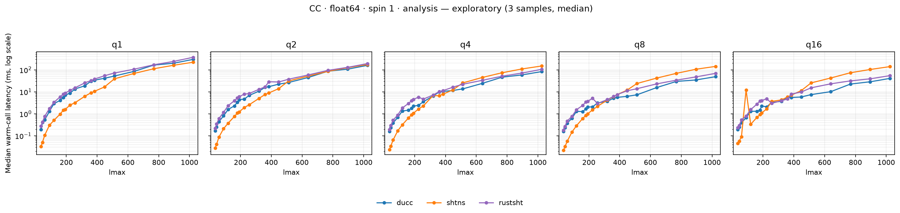

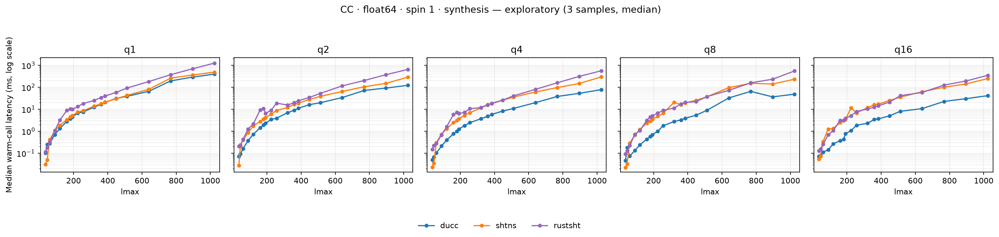

At q1 and L1024, median warm-call latency in milliseconds was:

| Grid | Spin | Operation | DUCC | RustSHT dev | SHTns |
| --- | ---: | --- | ---: | ---: | ---: |
| GL | 0 | Analysis | 93.345 | 79.260 | 104.060 |
| GL | 0 | Synthesis | 137.072 | 301.487 | 109.483 |
| GL | 1 | Analysis | 194.427 | 320.390 | 202.657 |
| GL | 1 | Synthesis | 433.399 | 613.168 | 543.650 |
| CC | 0 | Analysis | 147.549 | 106.082 | 147.854 |
| CC | 0 | Synthesis | 191.600 | 303.356 | 255.174 |
| CC | 1 | Analysis | 299.217 | 372.585 | 221.792 |
| CC | 1 | Synthesis | 398.798 | 1,262.430 | 490.133 |

RustSHT `dev` is fastest for q1 scalar analysis at L1024 on both grids. It substantially improves scalar synthesis over the old RustSHT build, but remains slower than DUCC at q1; for spin-1 analysis and synthesis, q1 RustSHT is also slower than DUCC and SHTns at the top degree.

### Scalar synthesis: old versus new RustSHT

These are matched q1 float64 scalar-synthesis measurements. The `main/dev` column is old RustSHT latency divided by new latency; the `DUCC/dev` column is DUCC latency divided by new RustSHT latency. A ratio above 1 means the denominator has lower latency.

| Grid | L | DUCC ms | SHTns ms | RustSHT main ms | RustSHT dev ms | main/dev | DUCC/dev |
| --- | ---: | ---: | ---: | ---: | ---: | ---: | ---: |
| GL | 320 | 5.605 | 3.523 | 94.612 | 14.404 | 6.57× | 0.39× |
| GL | 512 | 18.255 | 13.594 | 351.980 | 41.036 | 8.58× | 0.45× |
| GL | 1024 | 137.072 | 109.483 | 2,568.761 | 301.487 | 8.52× | 0.46× |
| CC | 320 | 5.033 | 4.315 | 96.244 | 15.437 | 6.24× | 0.33× |
| CC | 512 | 15.912 | 18.610 | 352.888 | 43.151 | 8.18× | 0.37× |
| CC | 1024 | 191.600 | 255.174 | 2,545.463 | 303.356 | 8.39× | 0.63× |

The dev build cuts q1 scalar-synthesis latency by 6.2–8.6× at these degrees. DUCC is still about 1.6–3.1× faster than RustSHT dev on these matched cells. SHTns is faster than RustSHT at all six points.

### Thread scaling at L1024

The table gives q1-to-q16 speedup for float64 medians. The figures show the complete degree curves for every thread panel.

| Grid | Spin | Operation | DUCC | RustSHT dev | SHTns |
| --- | ---: | --- | ---: | ---: | ---: |
| GL | 0 | Analysis | 6.34× | 8.51× | 6.00× |
| GL | 0 | Synthesis | 6.55× | 9.81× | 4.39× |
| GL | 1 | Analysis | 6.86× | 9.54× | 6.03× |
| GL | 1 | Synthesis | 10.30× | 2.64× | 6.96× |
| CC | 0 | Analysis | 7.15× | 5.56× | 1.38× |
| CC | 0 | Synthesis | 9.60× | 9.52× | 1.84× |
| CC | 1 | Analysis | 7.35× | 6.84× | 1.58× |
| CC | 1 | Synthesis | 9.59× | 3.59× | 1.95× |

RustSHT's dev scaling varies by operation: q16 gives strong scalar speedups on both grids, while GL spin-1 synthesis and CC spin-1 synthesis scale less. SHTns CC q1-to-q16 gains remain modest.

## Float32 secondary results

The next eight figures compare DUCC and RustSHT at q1/q2/q4/q8/q16, with pyspharm at q1 only.

### GL, float32

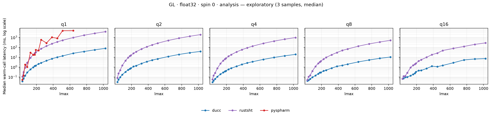

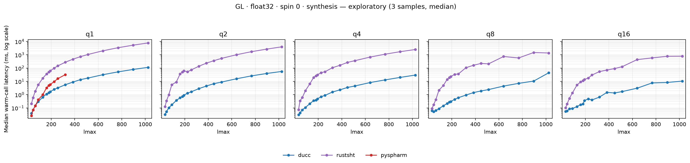

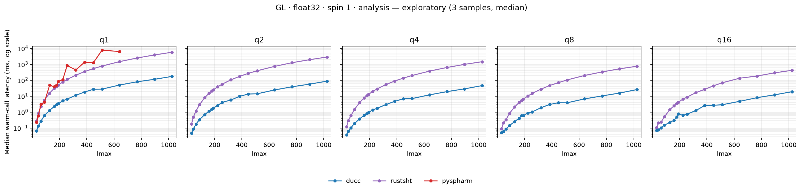

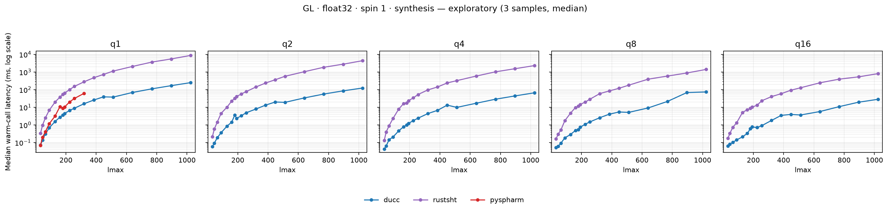

### CC, float32

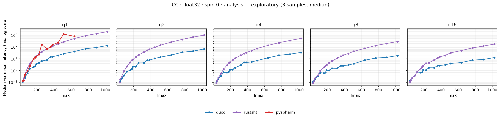

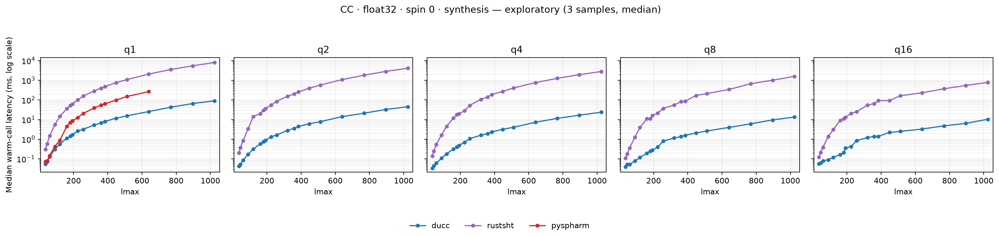

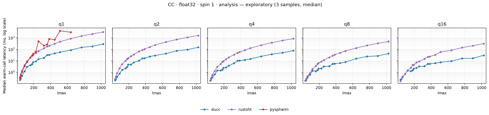

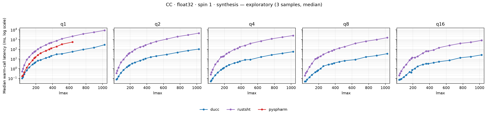

The dev changes did not improve float32 overall. Across 148 matched q1 RustSHT cells, dev was faster in 17; the geometric mean of `main latency / dev latency` was 0.972, about 2.9% higher dev latency overall. At GL L1024 spin-1 analysis, dev measured 5,727.62 ms versus 5,409.54 ms on main; CC measured 3,132.66 ms versus 2,894.98 ms. Do not infer that the float64 synthesis improvement carries over to float32.

## Notes and coverage

- The existing SHTns q8/q16 anomaly remains: intermittent plateaus around 12 ms occur at small and intermediate degrees. The merged figures preserve the baseline SHTns samples and flag those curves as suspect.
- Conda-forge pyspharm remains float32/q1 and hard-capped at L640. GL synthesis at L384, L448, L512, and L640 returned nonfinite outputs for both spins; those 8 failures remain visible as gaps. CC analysis and synthesis are available through L640.
- The merged matrix contains 3,816 successful timings, 8 execution failures, 864 API-capability exclusions, 48 explicit `degree_limit` exclusions, and no resource-limited cells. Pyspharm q2–q16 is recorded as unavailable because its public API has no native thread control.
- The original baseline is preserved at [results/gl-cc-resolution-scaling-l1024](../results/gl-cc-resolution-scaling-l1024/). The new RustSHT-only raw run is at [results/gl-cc-resolution-scaling-rustsht-dev-3194dc09](../results/gl-cc-resolution-scaling-rustsht-dev-3194dc09/).

## Data, provenance, and reproduction

The merged [CSV](../results/gl-cc-resolution-scaling-dev-refresh/timings.csv), [JSON](../results/gl-cc-resolution-scaling-dev-refresh/timings.json), [status record](../results/gl-cc-resolution-scaling-dev-refresh/statuses.json), [figure gallery](../results/gl-cc-resolution-scaling-dev-refresh/plots/README.md), and per-backend [build manifest](../results/gl-cc-resolution-scaling-dev-refresh/build-manifest.json) are committed together. The manifest records RustSHT `dev` commit `3194dc095c71343931b2ba0cfa0fc4f72dcab4cf`, extension SHA256 `793def549f49f62f317f3635df1b5b683f1dede660ed3f446c865b4d83d53b51`, Python 3.14.9, NumPy 2.5.4, and rustc/cargo 1.99.0. Baseline DUCC, SHTns, and pyspharm provenance remains attached to their original records.

Recreate the RustSHT-only measurements and merge them without rerunning other backends:

```bash
env -u OMP_WAIT_POLICY uv run --extra plot python scripts/run_fast_scaling.py \
  --build-manifest results/gl-cc-resolution-scaling-rustsht-dev-build-3194dc09/build-manifest.json \
  --output results/gl-cc-resolution-scaling-rustsht-dev-3194dc09-reproduction \
  --profile dense-to-1024 --backend rustsht --grid GL,CC \
  --threads 1,2,4,8,16 --precision float64,float32 \
  --min-time 0.005 --timeout 180

uv run --extra plot python scripts/merge_scaling_results.py \
  --baseline results/gl-cc-resolution-scaling-l1024 \
  --rustsht-refresh results/gl-cc-resolution-scaling-rustsht-dev-3194dc09-reproduction \
  --output results/gl-cc-resolution-scaling-dev-refresh-reproduction
```

Regenerate the merged 16 figures without transforms:

```bash
uv run --extra plot python scripts/run_fast_scaling.py \
  --output results/gl-cc-resolution-scaling-dev-refresh-reproduction --replot
```
