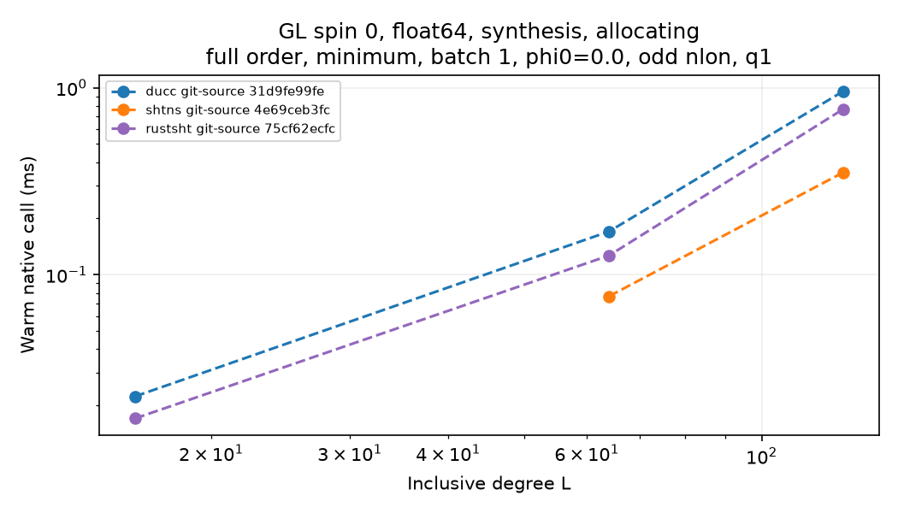
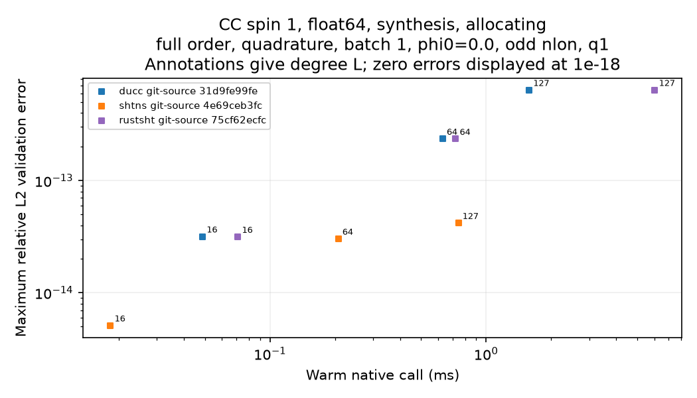
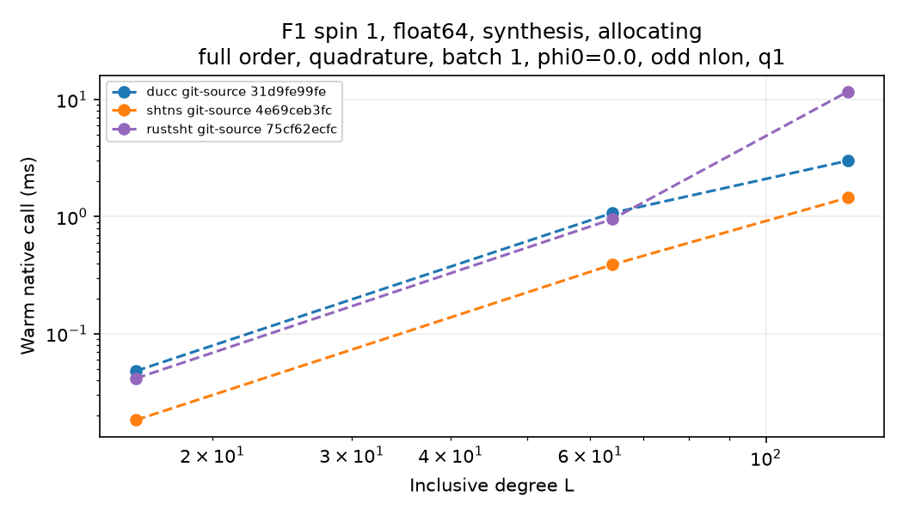

# Spherical harmonic transform benchmark results: 2026-10-22 run and 2026-10-25 pyspharm refresh

## Status

This report retains the original source-matrix context and focused L64
results for DUCC, SHTns, and RustSHT. The active pyspharm results were replaced
by the conda-forge rerun documented in the [current results report](PYSPHARM_CONDA_RESULTS_2026-10-25.md).
The focused matrix has one complete independent process round and a partial
second round; its q2–q16 performance is provisional and does not establish
stable thread scaling.

The original primary-plus-secondary plan requested 1,790,880 outcomes. It was
stopped at an atomic cell boundary after 16,499 valid cell files: 8,415 timed,
6,924 unsupported, 1,160 numerically invalid, and 0 execution failures. The
remaining 1,774,381 outcomes are pending, not completed. Its measured rate was
about 1.65 outcomes/s, implying about 12.5 days for the then-remaining plan.
The audit found consistent evidence but incomplete coverage. The exhaustive
run remains stopped and was not restarted for the dependency migration.

The first reduced plan requested 20,160 outcomes across DUCC, SHTns, and
RustSHT at q1/q2/q4/q8/q16 in three process rounds. Besides L64, its nonsmoke
planner added CC regular cases at L36, L60, L72, L90, L120, L180, L360, and
L720. It was stopped at 21:38:55 UTC after 984 valid outcome files: 644 timed,
240 unsupported, 100 numerically invalid, and 0 execution failures. The
remaining 19,176 outcomes are pending, not completed. The audit found
consistent evidence with incomplete coverage. Its measured rate was 1.324
outcomes/s over 743 seconds; L360 and L720 had not started. Per-degree, L36
has 480 cells (360 timed, 120 unsupported), L60 has 24 timed cells, and L64
has 480 cells (260 timed, 120 unsupported, 100 numerically invalid).

The focused official-runner plan used `--degrees 64 --smoke`, the locked build,
DUCC/SHTns/RustSHT, q1/q2/q4/q8/q16, three process rounds, 30 repetitions, and
the unchanged timing boundary. Its 48 base workloads expand to 8,640 outcomes
across minimum GL/CC/F1, quadrature CC/F1, and extended GL. Both spins, full
and quarter order, float64 and incidental float32, analysis/synthesis, and
allocating/preallocated calls are distinct workload dimensions. The 480
completed L64 cells from the preceding run were copied unchanged after their
IDs, tasks, source/build/harness hashes, and target-plan membership were
verified.

The run stopped safely at the q16 cell boundary after 4,844 of 8,640 outcomes:
3,184 timed, 1,200 unsupported, 460 numerically invalid, and 0 execution
failures. Round 0 is complete (2,880 outcomes: 1,920 timed, 720 unsupported,
240 invalid); round 1 contains 1,964 outcomes (1,264 timed, 480 unsupported,
220 invalid); round 2 did not start. Thus 3,796 cells remain pending, including
916 in round 1. The nonterminal ledger contains only the 2,880 round-0 cells.
The final audit reports `evidence_consistent=true`, `coverage_complete=false`,
zero unexpected cells, and zero evidence issues. IDs, filename identities,
source SHAs, build-manifest hashes, and frozen-harness hashes matched; no
temporary files or duplicate IDs were found.

In this matrix, `q` denotes requested backend threads. Per-backend outcomes
were DUCC 1,614 timed; RustSHT 1,075 timed, 400 unsupported, and 140
numerically invalid; SHTns 495 timed, 800 unsupported, and 320 numerically
invalid. By precision, float32 had 1,060 timed, 1,200 unsupported, and 140
invalid outcomes; float64 had 2,124 timed and 320 invalid outcomes, with no
unsupported float64 cells. These totals include the 480 unchanged seed cells.
The unsupported outcomes are 800 SHTns float32 cases (its Python API uses
float64/complex128) and 400 RustSHT float32 preallocated cases (`ShtPlan32`
exposes no output-buffer methods). No unsupported combination was replaced
with a different backend or allocation mode.

The completed round 0 supplies one independent process observation for every
planned backend/workload/q combination. Each cell retains 30 warm samples.
The runner alternated/reversed backend order by process round; it did not
randomize run order.
The partial round 1 adds a second process observation to only part of the
matrix, so q2–q16 comparisons are preliminary. The run produced 0.968 new
outcomes/s overall. The last short window was q16-dominated and highly
variable: two completed files over 337.6 seconds, with a 179.9-second gap
between writes. Two SHTns GL-minimum q16 cells took 151 and 191 seconds to
write; their warm medians were 2.51 and 2.96 seconds per transform. The run
was stopped after the current q16 cell passed validation rather than spending
hours on an unstable remainder. These outliers remain in the raw data; they
were not dropped or retried.

## Matched q1 smoke comparison

The six rows below use `lmax=mmax=64`, float64/complex128, allocating
synthesis, batch 1, longitude origin 0, and one requested thread. GL uses its
65×129 minimum grid; CC and F1 use their distinct 130×129 quadrature grids.
Each backend has three isolated process rounds and 30 repetitions per cell.
All 54 selected backend-round cells passed numerical validation. Latencies are
medians of the three round-level cell medians. Ratios and absolute differences
are calculated within each matched process round and then summarized by their
median, so they need not equal ratios or differences of the displayed latency
medians. Negative differences indicate a shorter observed latency than DUCC.

| Grid | Spin | DUCC (ms) | RustSHT (ms) | RustSHT / DUCC | RustSHT − DUCC (ms) | SHTns (ms) | SHTns / DUCC | SHTns − DUCC (ms) |
| --- | ---: | ---: | ---: | ---: | ---: | ---: | ---: | ---: |
| GL minimum, 65×129 | 0 | 0.170303 | 0.126679 | 0.7438 | −0.043624 | 0.076710 | 0.4504 | −0.093593 |
| GL minimum, 65×129 | 1 | 0.319506 | 0.296282 | 0.9792 | −0.011541 | 0.131872 | 0.4125 | −0.187738 |
| CC quadrature, 130×129 | 0 | 0.284753 | 0.311770 | 1.0965 | +0.024453 | 0.120481 | 0.3880 | −0.174282 |
| CC quadrature, 130×129 | 1 | 0.629237 | 0.722580 | 1.1787 | +0.109572 | 0.207085 | 0.3233 | −0.425779 |
| F1 quadrature, 130×129 | 0 | 0.490269 | 0.489648 | 0.9825 | −0.004749 | 0.194551 | 0.3922 | −0.295718 |
| F1 quadrature, 130×129 | 1 | 1.076102 | 0.953413 | 0.8860 | −0.119491 | 0.389366 | 0.3618 | −0.662889 |

SHTns had the lowest observed median latency in all six matched smoke cases.
RustSHT was faster than DUCC on the GL minimum cases and F1 spin-1, nearly
matched it on F1 spin-0, and slower on both CC quadrature cases. These are
workload-specific warm-call measurements on a shared host; they do not
establish algorithmic cause, broad superiority, or scaling behavior. Setup and
first-call diagnostics are reported separately and are not part of the warm
transform timing above.

The largest recorded relative L2 errors among the selected cells were
2.35e-13 for DUCC, 3.46e-13 for RustSHT, and 3.32e-14 for SHTns, against the
unchanged float64 tolerance of 2e-10. These maxima apply to the selected smoke
fixtures only.

## Focused L64 q-matrix

The table below uses only the complete round-0 process for the focused
matrix. Latencies are medians of each cell's 30 warm samples, then medians
across four float64 worksets (spin 0/1 × full/quarter order) in that grid.
RustSHT/DUCC and SHTns/DUCC ratios are computed for each matched workset and
then summarized by their median; they need not equal ratios of the displayed
latencies. Each row therefore has four matched spin/order cases and one
independent process pair per case. Setup and first-call measurements are
excluded from these warm-call values.

| Geometry | q | DUCC (ms) | RustSHT (ms) | SHTns (ms) | RustSHT / DUCC | SHTns / DUCC |
| --- | ---: | ---: | ---: | ---: | ---: | ---: |
| GL minimum | 1 | 0.1836 | 0.1496 | 0.0868 | 0.803 | 0.476 |
| GL minimum | 2 | 0.1659 | 0.2086 | 0.2611 | 1.165 | 1.441 |
| GL minimum | 4 | 0.1006 | 0.1526 | 0.2425 | 1.427 | 2.261 |
| GL minimum | 8 | 0.0846 | 0.1255 | 0.2898 | 1.372 | 3.523 |
| GL minimum | 16 | 0.0920 | 0.1529 | 0.5326 | 1.397 | 5.235 |
| CC quadrature | 1 | 0.3416 | 0.3536 | 0.1415 | 1.014 | 0.407 |
| CC quadrature | 2 | 0.2702 | 0.3551 | 0.0860 | 1.253 | 0.361 |
| CC quadrature | 4 | 0.1693 | 0.3871 | 0.0576 | 2.296 | 0.334 |
| CC quadrature | 8 | 0.1196 | 0.3690 | 6.0198 | 3.014 | 57.821 |
| CC quadrature | 16 | 0.1205 | 0.3459 | 0.0494 | 2.843 | 0.370 |
| F1 quadrature | 1 | 0.3633 | 0.2898 | 0.1617 | 0.823 | 0.407 |
| F1 quadrature | 2 | 0.2754 | 0.3386 | 0.0919 | 1.164 | 0.319 |
| F1 quadrature | 4 | 0.1709 | 0.3801 | 0.0585 | 2.165 | 0.325 |
| F1 quadrature | 8 | 0.1224 | 0.3426 | 0.0370 | 2.792 | 0.313 |
| F1 quadrature | 16 | 0.1203 | 0.3239 | 0.0516 | 2.652 | 0.367 |

In this single process round, SHTns has the lowest aggregated warm synthesis
median at q1 in all three selected geometries. At q2–q16, SHTns remains lower
than DUCC on the CC/F1 quadrature rows except for a large CC q8 outlier; it is
slower than DUCC on GL minimum. RustSHT is close to DUCC at q1, then has higher
aggregated medians in these cases. The CC q8 SHTns median includes two valid
spin/order cells at 12–18 ms and is sensitive to those observations. These
results are provisional: round 0 is the only complete process round, and
round-1 q16 SHTns results differ by orders of magnitude on repeated GL-minimum
workloads.

The complete round-0 float64 q-scaling summary aggregates by backend, geometry,
operation, allocation, and q. The refreshed pyspharm per-cell source timings
and matched q1 data are tracked in the [current result data directory](data/pyspharm-conda-forge-2026-10-25/README.md).

The eight q-thread figures use round-0 float64 warm samples only. Panels separate
grid, spin, full/quarter order, operation, and allocation; backend colors are
fixed across figures. SHTns minimum-CC/F1 analysis failures are absent from
those analysis panels because only timed, validated cells are plotted.

| Spin | Operation | Allocation | Figure |
| ---: | --- | --- | --- |
| 0 | synthesis | allocating | [Plot](figures/source-20261022/L64-f64-spin0-allocating-synthesis-round0.png) |
| 0 | synthesis | preallocated | [Plot](figures/source-20261022/L64-f64-spin0-preallocated-synthesis-round0.png) |
| 0 | analysis | allocating | [Plot](figures/source-20261022/L64-f64-spin0-allocating-analysis-round0.png) |
| 0 | analysis | preallocated | [Plot](figures/source-20261022/L64-f64-spin0-preallocated-analysis-round0.png) |
| 1 | synthesis | allocating | [Plot](figures/source-20261022/L64-f64-spin1-allocating-synthesis-round0.png) |
| 1 | synthesis | preallocated | [Plot](figures/source-20261022/L64-f64-spin1-preallocated-synthesis-round0.png) |
| 1 | analysis | allocating | [Plot](figures/source-20261022/L64-f64-spin1-allocating-analysis-round0.png) |
| 1 | analysis | preallocated | [Plot](figures/source-20261022/L64-f64-spin1-preallocated-analysis-round0.png) |

The `timings.csv` keeps adapter setup, native constructor/grid
precomputation, operation preparation, first requested operation, first A/S
calls, and warm samples in separate columns. For example, SHTns GL-minimum
float64 scalar q16 analysis in round 0 measured 0.344 ms allocating and
0.445 ms preallocated, while round 1 measured 2,514 ms and 2,961 ms. Native
setup was 143.0 ms and 4,630.0 ms in round 0 versus 9,293.5 ms and 15,644.5 ms
in round 1. The round-1 SHTns GL-minimum q16 allocating synthesis cell took
80.64 seconds for 30 warm samples (2,666 ms median) and 15.92 seconds native
setup. These cells passed numerical validation. The process-to-process
discrepancy, together with high SHTns setup variability, prevents a reliable
q16 performance or scaling claim from this partial matrix.

## Validation and execution failures retained

The focused L64 matrix produced 460 numerical validation failures and no
execution failures. The failures are localized in the requested workload
dimensions as follows:

| Backend | Precision | Grid and geometry | Spin | Failed cells | Validation category |
| --- | --- | --- | ---: | ---: | --- |
| RustSHT | float32 | CC minimum | 0 | 40 | High-mode numerical validation |
| RustSHT | float32 | GL minimum | 0 | 20 | High-mode numerical validation |
| RustSHT | float32 | F1 quadrature | 0, 1 | 40 each | High-mode numerical validation |
| SHTns | float64 | CC minimum | 0, 1 | 80 each | Coefficient recovery and map round-trip failed; synthesis passed |
| SHTns | float64 | F1 minimum | 0, 1 | 80 each | Coefficient recovery and map round-trip failed; synthesis passed |

For RustSHT, the failing fixtures exceed the unchanged float32 relative-L2
tolerance in high-mode synthesis, map round-trip, or both. For SHTns, the
failing cells exceed the unchanged float64 tolerance in coefficient recovery
and map round-trip while their synthesis checks pass. The available evidence
identifies the failing checks, not their underlying cause. No retry, tolerance
change, or grid substitution was made.

Successful focused-cell accuracy maxima are summarized below. Each entry is
the maximum over successful cells at the indicated backend and precision;
failed cells are excluded. Relative-L2 tolerances remained 2e-10 for float64
and 5e-5 for float32. “Scaled” is the bounded relative-error metric recorded
by the validator.

| Backend | Precision | Synthesis relative L2 | Synthesis max absolute | Synthesis scaled error |
| --- | --- | ---: | ---: | ---: |
| DUCC | float64 | 3.15e-13 | 2.65e-13 | 4.16e-13 |
| SHTns | float64 | 4.21e-13 | 3.54e-13 | 5.54e-13 |
| RustSHT | float64 | 4.81e-13 | 5.08e-13 | 6.33e-13 |
| DUCC | float32 | 5.56e-8 | 9.95e-8 | 4.72e-8 |
| RustSHT | float32 | 3.55e-5 | 1.03e-4 | 3.89e-5 |

For successful float64 fixtures, the maximum coefficient-recovery and map
round-trip relative-L2 errors were respectively 2.82e-14 and 6.97e-14 for
DUCC, 9.33e-12 and 9.33e-12 for SHTns, and 3.54e-14 and 1.23e-13 for
RustSHT. The refreshed pyspharm stage-by-stage values are in the [tracked
accuracy export](data/pyspharm-conda-forge-2026-10-25/source-q1-accuracy.csv).
These checks describe agreement with the benchmark's
numerical references and round-trip criteria; they are not a broader
scientific validation.

The refreshed q1 source matrix records 7,296 outcomes: 3,684 timed after
validation, 354 numerically invalid, 3,258 unsupported, and no execution
failures. Invalid and unsupported outcomes remain explicit and are excluded
from timing comparisons.

| Backend | Failure count and scope | Observed category |
| --- | --- | --- |
| SHTns | 192 float64: CC minimum 96 and F1 minimum 96 | Minimum-grid coefficient recovery and round-trip checks failed while independent synthesis passed; no underlying cause is inferred here. |
| RustSHT | 162 float32 across CC/F1/GL minimum and quadrature geometries | High-mode synthesis and/or map round-trip errors exceeded the unchanged float32 tolerance. |

No pyspharm numerical or execution failures occurred in the refreshed q1 run.
The 18 GL-minimum spin-1 outcomes at `nlat=L+1` are unsupported because the
highest-degree modes are unobservable there. A direct probe also confirms
`vhsgsi ierror=3` for GL 32×33 at L16 on the conda build; affected workload
variants are marked unsupported without retry. The current acceptance
criteria were not changed.

## Source and build provenance

| Backend | Selected source ref | Source SHA |
| --- | --- | --- |
| DUCC | ducc0 | `31d9fe99fefa5ca29df17b7e6d2362b8c5c4a05f` |
| SHTns | master | `4e69ceb3fc5f19475d55b03ff0fdec210dc3075e` |
| RustSHT | main | `75cf62ecfc4a324fc4f7d9e652c3d285dbf32cc4` |

The refreshed q1 smoke build manifest SHA-256 is
`d6fe72d153a3357828f7ca52d865ee08de462d11e0e915f2e4e05092ca14286b`.
The reduced locked build manifest SHA-256 is
`368e33170d308a7edf8d1ff2bac3889b772f545b6e8173d4d2447e0f7c218254`; its
frozen harness SHA-256 is
`5d4e7baf0367bf7fdfd96176f48e446edf177bc9a399b31d35451f7bc84f8f27`.
The original and locked DUCC, SHTns, and RustSHT source SHAs and effective
compiler settings match. Their binary hashes are not all identical, so the
reproduction supports source/configuration reproducibility, not bitwise-identical
builds. The conda-forge pyspharm artifact and native extension hashes are
recorded in the [current environment provenance](../environments/pyspharm-conda-forge-linux-64.provenance.json).

The locked-versus-original reproduction review contains 216 matched cells,
all numerically validated with 30 timing samples each. Across 18 process
pairs per backend and operation, median locked/original latency ratios were
0.992/1.003 for DUCC synthesis/analysis, 0.995/0.995 for SHTns, and
0.996/1.010 for RustSHT. Pair ranges extend from 0.645 to 1.454, consistent
with material run-to-run variability on this shared host. These ratios check
reproduction at a fixed source SHA and are not cross-backend performance
comparisons. The source SHAs, locked build manifest, and reproduction table
are summarized here; the active package-specific evidence is tracked in the
current result data directory linked below.

The captured host is an AMD Ryzen 9 5950X with 16 physical and 32 logical
cores. It is a shared host with boost enabled. RustSHT's build records
`target-cpu=native`; recorded Pulp compile features include x86-v3 and x86-v4,
while the host does not advertise AVX-512. Compile features are not evidence
of runtime dispatch. CPU-affinity, power and contention limits constrain
generalization beyond this host.

## Current tracked result data

The active pyspharm measurements, unsupported outcomes, numerical metrics,
and matched q1 comparisons are published in the [conda-forge results report](PYSPHARM_CONDA_RESULTS_2026-10-25.md)
and its [machine-readable data](data/pyspharm-conda-forge-2026-10-25/README.md).
The tracked [AMD64 plot gallery](../results/matrix/plots/README.md) has been
regenerated from the active matrix, which contains conda-forge pyspharm rows.
The exhaustive source sweep and focused L64 q-matrix remain incomplete as
described above; no unexecuted cell is reported as complete.
