# GL/CC resolution scaling figures

Exploratory native allocating warm-call timings. Each figure separates grid, precision, spin and direction; the five panels show q1/q2/q4/q8/q16. Markers show measured points; line segments stop at missing or failed degrees. Float64 figures precede float32. SHTns is available at float64; conda-forge pyspharm is available at float32 and q1 only, with a hard L640 ceiling.

## GL · float64 · spin0 · analysis

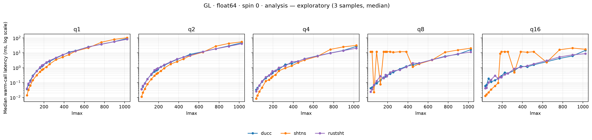

## GL · float64 · spin0 · synthesis

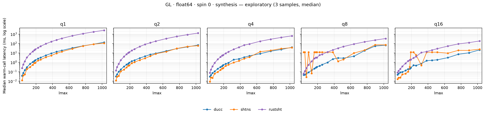

## GL · float64 · spin1 · analysis

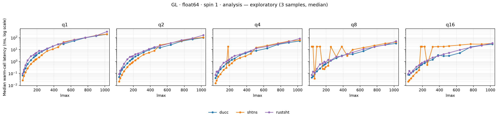

## GL · float64 · spin1 · synthesis

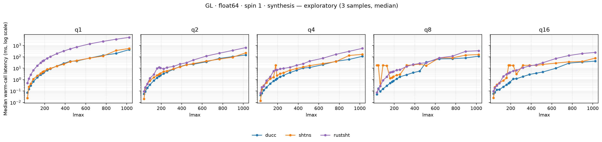

## CC · float64 · spin0 · analysis

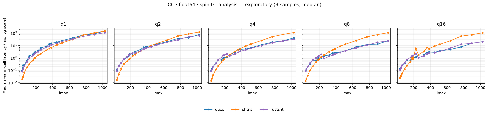

## CC · float64 · spin0 · synthesis

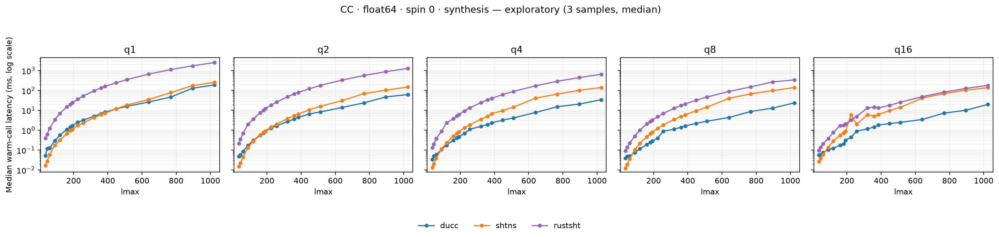

## CC · float64 · spin1 · analysis

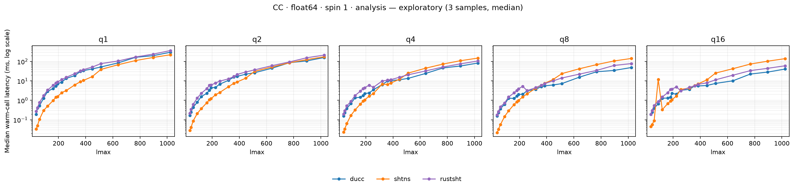

## CC · float64 · spin1 · synthesis

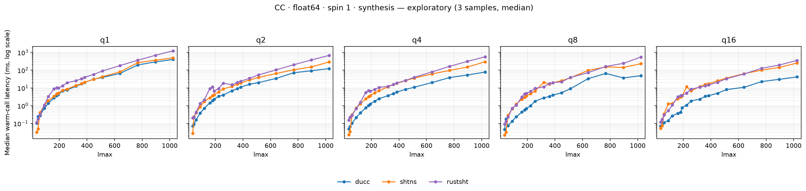

## GL · float32 · spin0 · analysis

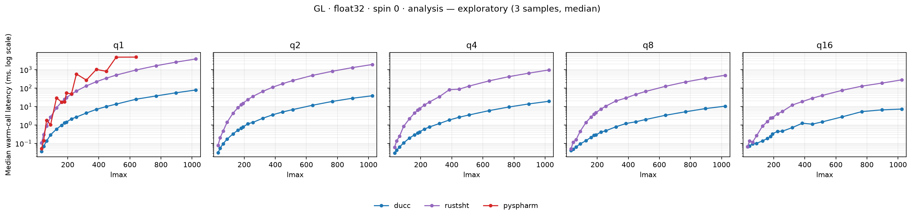

## GL · float32 · spin0 · synthesis

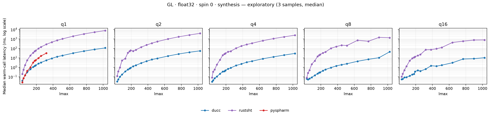

## GL · float32 · spin1 · analysis

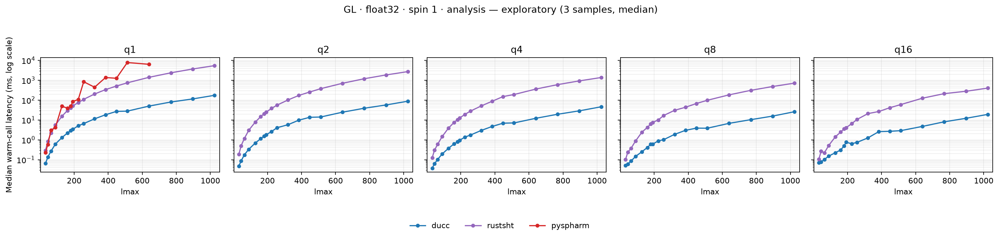

## GL · float32 · spin1 · synthesis

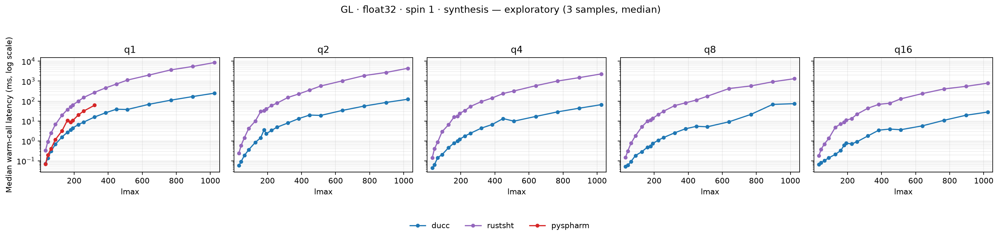

## CC · float32 · spin0 · analysis

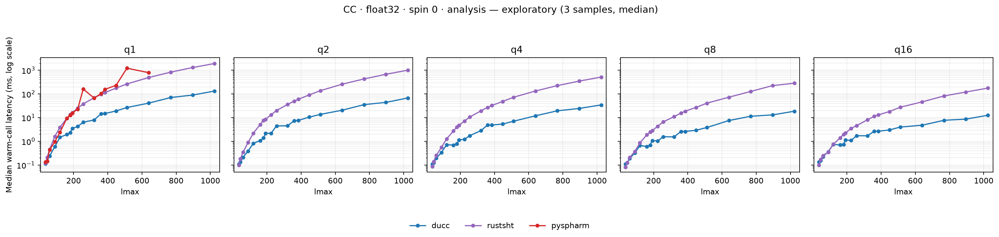

## CC · float32 · spin0 · synthesis

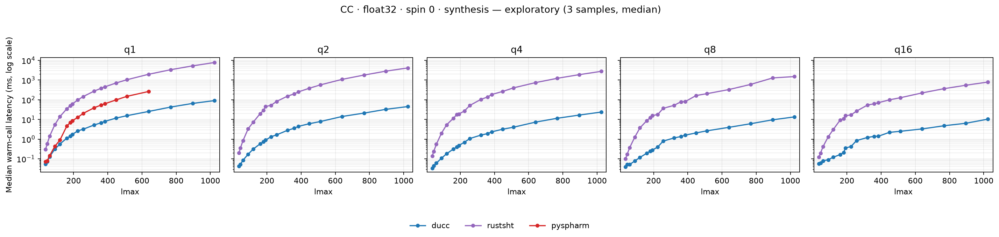

## CC · float32 · spin1 · analysis

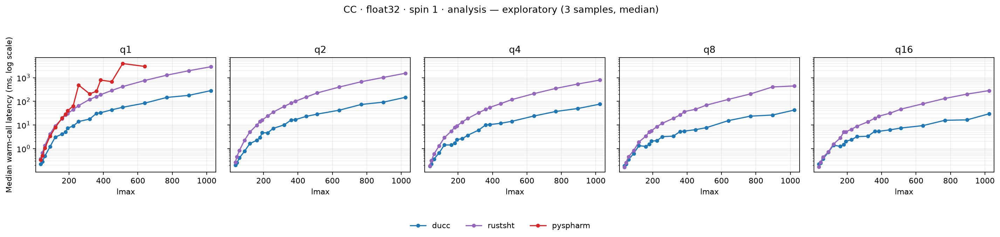

## CC · float32 · spin1 · synthesis

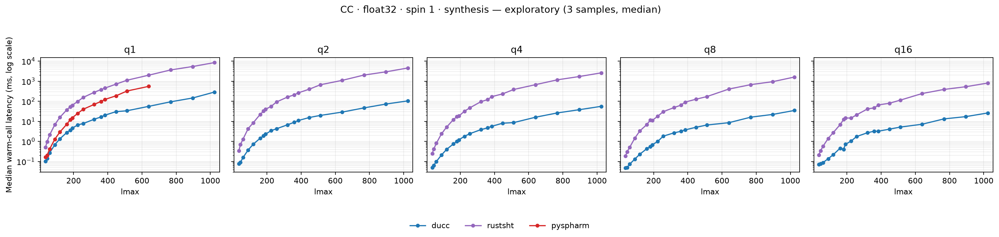
